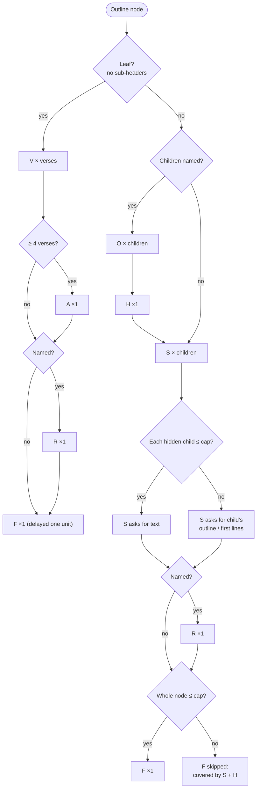
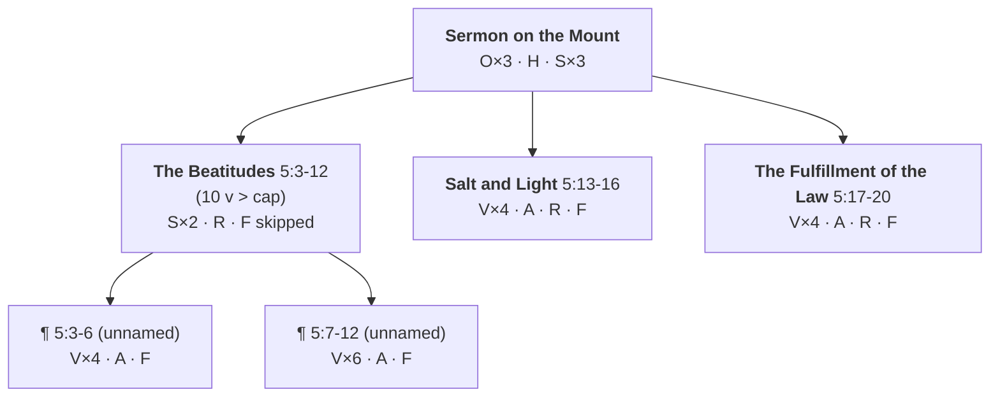

# Proposed Deck Ordering & Difficulty System (TODO 2)

Diagrams use Mermaid. They render on GitHub, and in VS Code with a Mermaid preview extension (e.g. "Markdown Preview Mermaid Support").

## Core idea

Difficulty levels are **attached to positions in the outline tree**, not to absolute text sizes. That way one rule set works for both Romans 8:1-12 and all of Luke.

- **Leaf** = a paragraph (no sub-headers). Its cards test **text**.
- **Internal node** = a header with children. Its cards test **structure**, plus recall of whole children when they're small enough.
- **Answer cap**: no card asks for more than ~8 verses or ~7 outline lines. If something is too big to recite, the card asks for its **outline** (or first lines) instead.
- **Order** = walk the tree in reading order and add each node's cards **after its children's** (post-order). The full-recall card is **delayed by one unit**.

---

## 1. Card types

| Code | Applies to | Card | Your level |
|---|---|---|---|
| **V** | leaf | Scaffolded verse cloze: one card per verse, other verses visible | L3 |
| **A** | leaf, ≥ 4 verses | Anchored: first & last verse visible, middle hidden | L3→L4 |
| **R** | named node | Reverse: text → header (text shown as first lines if over cap) | L2 |
| **F** | leaf, or node ≤ cap | Forward: header + breadcrumb → recite the whole thing | L5 (local) |
| **O** | internal node, named children | Outline cloze: child-header list with one header hidden (one card per child) | L1 |
| **H** | internal node, named children | Header → recite the list of child headers | L5 (structural) |
| **S** | internal node | Missing child: siblings visible, one child hidden; recite it (text if ≤ cap, else its outline / first lines) | L4 |

Every card shows the **breadcrumb** (e.g. `Sermon on the Mount › The Beatitudes`) and the visible sibling headers as context. The outline is always on screen, even before it's tested.

---

## 2. Which cards a node gets



At the top of a long book, nearly every card becomes structural (**O/H/S** asking for outlines). At the bottom it's all text (**V/A/F**). Recalling "all of Luke" therefore means recalling outlines that lead you down to recalling paragraphs.

---

## 3. Worked example: Matthew 5:3-20

### Tree (cap = 8 verses)



Salt and Light and Fulfillment are named **leaves**: headers with a single paragraph and no sub-headers.

### Introduction order (the deck's due order)

Post-order traversal, with each unit's **F** pushed back behind the next unit's first cards. Day markers assume **15 new cards/day**.

```
 #      Unit                  Cards                          Why here
────────────────────────────────────────────────────────────────────────────────
 1–5    ¶ 5:3-6               V V V V A                      first leaf
 6–12   ¶ 5:7-12              V V V V V V A                  next leaf
 13     ¶ 5:3-6               F                              delayed 1 unit
 ───────────────────────────── day 1 ends (15) ─────────────────────────────
 14–17  ¶ 5:7-12 + Beatitudes F · S S · R                    Beatitudes closes; a last
                                                             child's F isn't delayed, it
                                                             goes just before its parent
 18–23  Salt and Light        V V V V A R
 24–29  Fulfillment           V V V V A R
 30     Salt and Light        F                              delayed 1 unit
 ───────────────────────────── day 2 ends (30) ─────────────────────────────
 31–38  Fulfillment + SOM     F · O O O · H · S S S          root closes
 ───────────────────────────── day 3 (8 new) ───────────────────────────────
```

### The same order on a timeline

```mermaid
gantt
    title New-card introduction (15/day) — Matt 5:3-20
    dateFormat X
    axisFormat %s
    section ¶ 5:3-6
    V V V V A          :a1, 0, 5
    F (delayed)        :a2, 12, 13
    section ¶ 5:7-12
    V×6 A              :b1, 5, 12
    F                  :b2, 13, 14
    section The Beatitudes
    S S R              :c1, 14, 17
    section Salt and Light
    V×4 A R            :d1, 17, 23
    F (delayed)        :d2, 29, 30
    section Fulfillment
    V×4 A R            :e1, 23, 29
    F                  :e2, 30, 31
    section Sermon on the Mount
    O×3 H S×3          :f1, 31, 38
```



**Result:** 20 verses → 38 cards (≈ 1.9 per verse). Small examples run high because structural cards are a fixed overhead per header. Expect the ratio to fall toward ~1.6 on longer paragraphs. If it doesn't, **A** is the first card type to drop for paragraphs under 6 verses.

---

## 4. How the ordering keeps you from grinding on one paragraph

```
reading order ──────────────────────────────────────────────────────────▶

new cards     [¶1 V/A][¶2 V/A][¶1 F][¶2 F + Beat. S/R][S&L V/A/R][Fulf V/A/R][S&L F]...
                 │       │       │
reviews          └──┬────┴───────┴── FSRS keeps every earlier card cycling,
                    │                spaced further apart as each one stabilizes
                    ▼
working set = everything introduced in the last ~1–3 weeks
            ≈ "max_scope", set by new-cards/day instead of a hard rule
```

- **New cards/day** is the one setting that controls how much is in progress at once.
- The **one-unit delay** puts space between drilling a paragraph and the first time you recite it from memory.
- **Section cards (S/O/H) come right after a section's last child**, so going back up the outline happens while the pieces are still fresh.

---

## 5. Mapping to Anki

| Concern | Approach |
|---|---|
| Ordering | **One deck**; new-card position = row # above. Gather order "Deck", sort "Order gathered". Avoid subdecks per level, because Anki would pull all of one level before the next. |
| Levels / sections | Tags: `level::L3`, `type::V`, `sec::SOM::Beatitudes`. Use them for filtered decks and custom study, not for ordering. |
| Siblings | All **V** cards of a paragraph are one cloze note, so they're siblings. Bury siblings ("new" and "review"). Forward/reverse of one header are siblings too. |
| Scheduler | FSRS on, short learning steps (< 1 day). There's no ease factor, so no "ease hell". |
| Stable IDs | Note GUID = hash(translation, card type, verse refs). Never include header text, so editing a header doesn't reset progress. |
| Delivery | `.apkg` with note types, CSS and deck preset included, not CSV. |

---

## 6. Open questions

1. **Cap size**: is 8 verses right? It may need to be lower for poetry and higher for narrative. It could be set per deck in the YAML.
2. **Unnamed paragraphs**: how should **F** prompt for them? Options: breadcrumb + "¶ 2 of 2", or breadcrumb + the previous verse (chaining).
3. **First-letter mode** (`style: list` in YAML): does it replace **V** for that node or get added alongside it?
4. **Delay length**: one unit, or a fixed number of cards (e.g. F placed ≥ 10 positions later)?
5. **Pre-order vs post-order for outline cards**: showing the outline on every card is the compromise. Test whether people want **O** cards *before* the text instead.
